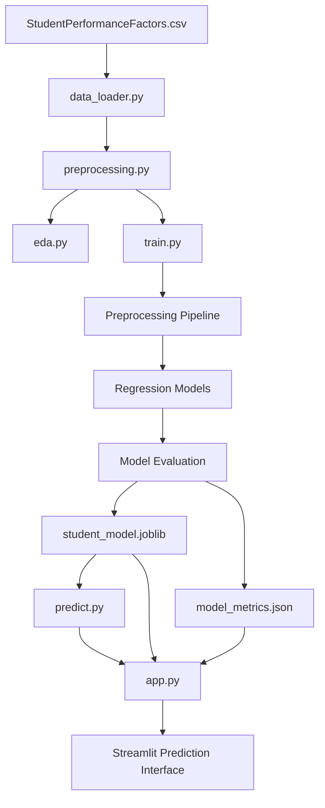

# 🎓 Student Performance Prediction Using Machine Learning

A Python-based Machine Learning project that analyzes student-related factors, explores patterns in academic performance, and predicts a student's exam score using regression models. The project includes Exploratory Data Analysis (EDA), data preprocessing, model evaluation, and an interactive Streamlit web application.

> **Project type:** Machine Learning · Regression · Data Science  
> **Interface:** Streamlit Web App  
> **Dataset:** `StudentPerformanceFactors.csv`  
> **Prediction target:** `Exam_Score`

---

## 📌 Table of Contents

1. [Project Overview](#-project-overview)
2. [Problem Statement](#-problem-statement)
3. [Proposed Solution](#-proposed-solution)
4. [Project Objectives](#-project-objectives)
5. [Features](#-features)
6. [Dataset Description](#-dataset-description)
7. [Technologies Used](#-technologies-used)
8. [Project Architecture](#-project-architecture)
9. [Project Folder Structure](#-project-folder-structure)
10. [Project Workflow](#-project-workflow)
11. [Machine Learning Approach](#-machine-learning-approach)
12. [Evaluation Metrics](#-evaluation-metrics)
13. [Installation and Setup](#-installation-and-setup)
14. [How to Run the Project](#-how-to-run-the-project)
15. [How to Use the Web Application](#-how-to-use-the-web-application)
16. [Output and Generated Files](#-output-and-generated-files)
17. [Testing](#-testing)
18. [Troubleshooting](#-troubleshooting)
19. [Limitations](#-limitations)
20. [Future Improvements](#-future-improvements)
21. [Learning Outcomes](#-learning-outcomes)
22. [Contributing](#-contributing)
23. [License](#-license)
24. [Author](#-author)

---

## 📖 Project Overview

Student Performance Prediction is a Machine Learning project designed to explore student performance data and estimate exam scores based on available student-related features.

The project follows a typical Data Science workflow:

- Load and validate a CSV dataset.
- Clean the data and handle missing values.
- Perform Exploratory Data Analysis.
- Prepare numerical and categorical features.
- Train and compare regression models.
- Evaluate model performance.
- Save the trained model.
- Deploy the model through an interactive Streamlit application.

The application allows users to enter student details and receive a model-generated exam score estimate.

The main goal is to demonstrate an end-to-end Machine Learning workflow, from raw data to an interactive prediction interface.

---

## ❓ Problem Statement

Student performance can be associated with several factors, such as study hours, attendance, previous scores, sleep habits, access to resources, and other student-related characteristics.

Understanding these relationships can be challenging when working with a large dataset.

Without appropriate data analysis tools, it can be difficult to:

- Understand the distribution of exam scores.
- Identify patterns between student characteristics and exam performance.
- Handle missing and categorical data correctly.
- Compare different Machine Learning algorithms.
- Evaluate whether a model makes useful predictions.
- Make a trained model accessible through a simple interface.

### Problem to solve

**How can we analyze student-related data and build a Machine Learning model that estimates a student's exam score from the available features?**

This project addresses the problem by combining data analysis, regression modeling, and a user-friendly web application.

---

## 💡 Proposed Solution

The proposed solution is an end-to-end Student Performance Prediction System built with Python and Scikit-learn.

The system processes the student dataset, explores patterns, trains regression models, and exposes the selected model through Streamlit.

### Solution components

**1. Data Loading**

Load the CSV file into a Pandas DataFrame and validate the target column.

**2. Data Cleaning**

Remove duplicate rows, validate the target values, and prepare the dataset for analysis.

**3. Exploratory Data Analysis**

Use statistical summaries and visualizations to explore score distributions and relationships among variables.

**4. Data Preprocessing**

- Fill missing numerical values using the median.
- Fill missing categorical values using the most frequent category.
- Scale numerical features.
- Encode categorical features using one-hot encoding.

**5. Model Training**

Train and compare:

- Dummy Regressor
- Linear Regression
- Random Forest Regressor

**6. Model Evaluation**

Compare the models using MAE, RMSE, and R².

**7. Model Persistence**

Save the complete preprocessing and model pipeline using Joblib.

**8. Web Application**

Build a Streamlit interface for data exploration, model metric visualization, and student score prediction.

---

## 🎯 Project Objectives

- Develop a complete Machine Learning project using Python.
- Practice data cleaning and preprocessing.
- Understand numerical and categorical feature handling.
- Perform meaningful Exploratory Data Analysis.
- Apply regression algorithms to a real-world-style dataset.
- Compare model performance using appropriate evaluation metrics.
- Prevent preprocessing data leakage by fitting transformations on training data.
- Save and reuse a trained Machine Learning pipeline.
- Develop an interactive web application using Streamlit.
- Create a project suitable for a Data Science portfolio.

---

## ✨ Features

| Feature | Description |
|---|---|
| CSV Data Loading | Reads the student performance dataset |
| Data Validation | Checks required columns and invalid target values |
| Data Cleaning | Removes duplicate rows and unusable target records |
| Missing Value Handling | Uses numerical and categorical imputers |
| Exploratory Data Analysis | Generates histograms, scatter plots, and correlation heatmaps |
| Multiple ML Models | Compares three regression approaches |
| Model Evaluation | Reports MAE, RMSE, and R² |
| Model Selection | Selects the candidate with the lowest test RMSE |
| Model Saving | Saves the preprocessing and estimator pipeline |
| Prediction Interface | Accepts student details through a Streamlit form |
| Performance Dashboard | Displays stored evaluation metrics |
| Reusable Architecture | Separates data, preprocessing, training, prediction, and UI code |

---

## 📊 Dataset Description

The project uses:

`StudentPerformanceFactors.csv`

Place this file inside the `data/` directory.

The dataset contains approximately 6,607 records and 20 columns, based on the supplied dataset.

The target column is:

`Exam_Score`

The model uses the other columns as input features.

### Example dataset columns

| Column | Description |
|---|---|
| `Hours_Studied` | Reported hours spent studying |
| `Attendance` | Student attendance measure |
| `Parental_Involvement` | Category describing parental involvement |
| `Access_to_Resources` | Category describing access to educational resources |
| `Extracurricular_Activities` | Participation in extracurricular activities |
| `Sleep_Hours` | Reported sleep duration |
| `Previous_Scores` | Previous academic score measure |
| `Motivation_Level` | Reported motivation category |
| `Internet_Access` | Internet access category |
| `Tutoring_Sessions` | Number of tutoring sessions |
| `Family_Income` | Family income category |
| `Teacher_Quality` | Teacher quality category |
| `School_Type` | School type |
| `Peer_Influence` | Reported peer influence category |
| `Physical_Activity` | Reported physical activity measure |
| `Learning_Disabilities` | Learning-disability indicator in the dataset |
| `Parental_Education_Level` | Parent education category |
| `Distance_from_Home` | Distance category |
| `Gender` | Gender category |
| `Exam_Score` | Target variable to predict |

The descriptions above are general interpretations of the column names. Refer to the original dataset documentation for precise definitions and units.

### Dataset preparation

Before running the project, ensure the file is located here:

```text
student-performance-ml/
└── data/
    └── StudentPerformanceFactors.csv
```

The project expects the target column to be named exactly `Exam_Score`.

**Data responsibility:** student-related information may be sensitive. Use the dataset responsibly, protect its contents, and avoid treating model predictions as definitive judgments about individual students.

---

## 🛠️ Technologies Used

| Technology | Purpose |
|---|---|
| Python | Core programming language |
| Pandas | Data manipulation and analysis |
| NumPy | Numerical operations |
| Matplotlib | Data visualization |
| Seaborn | Statistical charts |
| Scikit-learn | Preprocessing, regression, and evaluation |
| Joblib | Saving and loading the trained pipeline |
| Streamlit | Interactive web application |
| Pytest | Automated testing |

---

## 🏗️ Project Architecture

The project follows a modular architecture. Each module has a specific responsibility.



### Module responsibilities

**`src/data_loader.py`**

Loads the CSV, checks the target column, and provides a basic dataset inspection report.

**`src/preprocessing.py`**

Cleans the dataset, separates input features from the target, detects column types, and constructs the preprocessing pipeline.

**`src/eda.py`**

Generates charts and statistical summaries to explore student performance patterns.

**`src/train.py`**

Splits the data, trains regression candidates, calculates evaluation metrics, selects a candidate, and saves the model pipeline and metrics.

**`src/predict.py`**

Loads the saved pipeline and provides a reusable function for predicting an exam score from a feature dictionary.

**`src/utils.py`**

Contains reusable utility functions.

**`app.py`**

Provides the Streamlit interface for project overview, data exploration, model performance, and score prediction.

**`models/`**

Stores generated model and metric artifacts.

**`tests/`**

Contains automated tests for the project.

---

## 📁 Project Folder Structure

```text
student-performance-ml/
│
├── data/
│   └── StudentPerformanceFactors.csv
│
├── src/
│   ├── __init__.py
│   ├── data_loader.py
│   ├── preprocessing.py
│   ├── eda.py
│   ├── train.py
│   ├── predict.py
│   └── utils.py
│
├── models/
│   ├── student_model.joblib
│   └── model_metrics.json
│
├── tests/
│   ├── test_data_loader.py
│   └── test_predict.py
│
├── .streamlit/
│   └── config.toml
│
├── app.py
├── requirements.txt
├── README.md
└── .gitignore
```

The files inside `models/` are generated by the training script. They do not need to exist before the first training run.

---

## 🔄 Project Workflow

### Step 1: Load the data

Read the CSV using Pandas and validate that the target column exists.

### Step 2: Clean the data

Remove duplicate records and discard records that do not have a usable target value.

### Step 3: Explore the data

Analyze distributions, descriptive statistics, numerical correlations, and score patterns across selected categories.

### Step 4: Separate features and target

Define:

- `X`: all input features except `Exam_Score`.
- `y`: the `Exam_Score` target.

### Step 5: Split the dataset

Use an 80/20 train-test split with a fixed random seed for reproducibility.

### Step 6: Preprocess the features

Apply the numerical and categorical transformations through a Scikit-learn pipeline.

### Step 7: Train the models

Fit the Dummy Regressor, Linear Regression, and Random Forest Regressor.

### Step 8: Evaluate the candidates

Calculate MAE, RMSE, and R² on the held-out test set.

### Step 9: Save the artifacts

Save the selected model pipeline and model comparison metrics.

### Step 10: Launch the application

Start Streamlit and use the prediction form to generate estimates.

---

## 🧠 Machine Learning Approach

This project is a **supervised regression problem**.

The model learns from labeled examples, where student-related input features are paired with an observed exam score.

### Target variable

```python
TARGET_COLUMN = "Exam_Score"
```

### Input and output

```text
Input:
Student-related features

Output:
Predicted Exam_Score
```

### Models used

#### 1. Dummy Regressor

Provides a simple baseline by predicting the training-set mean.

It helps answer the question:

"Does a more sophisticated model improve on a basic mean prediction?"

#### 2. Linear Regression

Models a linear relationship between input features and the target.

It is a useful starting point because it is relatively simple to interpret.

#### 3. Random Forest Regressor

Combines multiple decision trees to learn more complex relationships.

It can capture nonlinear patterns and interactions that a basic linear model may not represent well.

### Model selection

The current training script selects the candidate with the lowest RMSE on the held-out test set.

This is a useful initial comparison for a learning project. For a more rigorous model-selection process, use cross-validation on the training data and reserve the test set for final evaluation. Selecting a model directly on test-set performance can make the reported test result optimistic.

No model is guaranteed to outperform the others before the experiment is run.

---

## 📏 Evaluation Metrics

The project calculates three regression metrics.

### Mean Absolute Error (MAE)

MAE measures the average absolute difference between actual and predicted scores.

```text
MAE = average absolute prediction error
```

A lower MAE indicates smaller average prediction errors.

### Root Mean Squared Error (RMSE)

RMSE measures prediction error while penalizing larger errors more strongly.

```text
RMSE = square root of the mean squared error
```

A lower RMSE is preferred when comparing models on the same evaluation data.

### R-squared (R²)

R² compares the model's predictions with a baseline that predicts the mean target value.

- A value near 1 indicates strong predictive fit relative to that baseline.
- A value near 0 indicates performance similar to the mean baseline in terms of the R² calculation.
- A negative value indicates worse performance than the mean baseline on the evaluated data.

R² is not a percentage accuracy score.

### Example interpretation

The following values are illustrative only and are not measured results from this project.

| Metric | Example | Interpretation |
|---|---:|---|
| MAE | 3.0 | Average absolute error of about 3 score points |
| RMSE | 4.0 | Larger errors affect this metric more strongly |
| R² | 0.75 | The model explains 75% of the test target variance relative to the R² definition |

Use the actual metrics generated by `python -m src.train` when reporting project results.

---

## 💻 Installation and Setup

### Prerequisites

Install the following:

- Python 3.10 or newer, preferably a version supported by all installed package versions.
- Visual Studio Code or another Python editor.
- Git, if you want to publish the project on GitHub.
- The `StudentPerformanceFactors.csv` dataset.

Check Python:

```powershell
python --version
```

Check pip:

```powershell
python -m pip --version
```

### Step 1: Create the project folder

If you have not already created it:

```powershell
mkdir student-performance-ml
cd student-performance-ml
```

If the project folder already exists, open that folder instead of creating another one.

### Step 2: Create a virtual environment

On Windows PowerShell:

```powershell
python -m venv .venv
```

Activate it:

```powershell
.\.venv\Scripts\Activate.ps1
```

If PowerShell blocks script activation, use the virtual environment's Python executable directly:

```powershell
.\.venv\Scripts\python.exe -m pip install --upgrade pip
```

On macOS or Linux:

```bash
python3 -m venv .venv
source .venv/bin/activate
```

### Step 3: Install dependencies

Create or update `requirements.txt` with:

```text
pandas
numpy
matplotlib
seaborn
scikit-learn
streamlit
joblib
pytest
```

Upgrade pip and install the packages:

```powershell
python -m pip install --upgrade pip
python -m pip install -r requirements.txt
```

If you use the Windows environment directly because activation is blocked:

```powershell
.\.venv\Scripts\python.exe -m pip install --upgrade pip
.\.venv\Scripts\python.exe -m pip install -r requirements.txt
```

For a reproducible project environment, record and pin the versions you successfully test after the application is working.

### Step 4: Place the dataset

Ensure the CSV is stored at:

```text
data/StudentPerformanceFactors.csv
```

If the file is in your Downloads directory, copy it using its actual path:

```powershell
Copy-Item "C:\path\to\StudentPerformanceFactors.csv" "data\StudentPerformanceFactors.csv"
```

Replace `C:\path\to\` with the actual location of the file.

### Step 5: Verify the dataset

Run:

```powershell
python -m src.data_loader
```

This should print the dataset dimensions, columns, data types, missing values, duplicate count, sample records, and target statistics.

### Step 6: Run preprocessing checks

```powershell
python -m src.preprocessing
```

The command should report the input features and the preprocessing pipeline.

---

## ▶️ How to Run the Project

Run the following commands from the project's root directory, where `app.py` and `requirements.txt` are located.

### 1. Inspect the dataset

```powershell
python -m src.data_loader
```

### 2. Check preprocessing

```powershell
python -m src.preprocessing
```

### 3. Perform Exploratory Data Analysis

```powershell
python -m src.eda
```

This generates charts and statistical summaries. In a desktop environment, Matplotlib may open separate chart windows.

### 4. Train and evaluate the models

```powershell
python -m src.train
```

The training script:

- Splits the dataset into training and test sets.
- Trains the three candidate models.
- Reports MAE, RMSE, and R².
- Selects the model with the lowest test RMSE.
- Saves the selected pipeline and metrics.

### 5. Verify the saved model

```powershell
python -c "import json, joblib; from pathlib import Path; p=Path('models'); m=joblib.load(p/'student_model.joblib'); d=json.loads((p/'model_metrics.json').read_text(encoding='utf-8')); print('Model:', type(m).__name__); print('Selected:', d['selected_model']); print(d['results'])"
```

Only load serialized model files from trusted sources.

### 6. Start the Streamlit application

```powershell
python -m streamlit run app.py
```

Streamlit prints a local URL in the terminal. Open that address in your web browser.

### 7. Use a different port if necessary

```powershell
python -m streamlit run app.py --server.port 8502
```

### 8. Stop the application

Press:

```text
Ctrl + C
```

in the terminal running Streamlit.

---

## 🖥️ How to Use the Web Application

The application contains four main pages.

### 1. Overview

Displays:

- Number of student records.
- Number of input features.
- Average exam score.
- A preview of the dataset.
- A summary of the project workflow.

### 2. Explore Data

Displays:

- Exam score distribution.
- Study hours versus exam score.
- Attendance versus exam score.
- Numerical correlation heatmap.
- Missing-value summary.

These visualizations help users explore the data before interpreting the model results.

### 3. Model Performance

Displays:

- The selected model.
- MAE, RMSE, and R² for each candidate.
- A comparison chart of test RMSE.
- The selected model's metrics.

### 4. Predict Score

Steps:

1. Open the Predict Score page.
2. Enter or select the available student features.
3. Click **Predict Exam Score**.
4. View the predicted exam score.
5. Compare it with the dataset's average score if useful.

The model output is an estimate, not a guarantee of future academic performance.

---

## 📂 Output and Generated Files

After successfully training the models, the project generates:

### `models/student_model.joblib`

Contains the selected Scikit-learn pipeline, including its fitted preprocessing transformations and regression estimator.

### `models/model_metrics.json`

Contains the target name, selected model, split configuration, training and testing row counts, feature count, and evaluation metrics for the candidate models.

Example structure:

```json
{
    "target": "Exam_Score",
    "selected_model": "Random Forest",
    "selection_metric": "RMSE",
    "test_size": 0.2,
    "random_state": 42,
    "training_rows": 5285,
    "testing_rows": 1322,
    "feature_count": 19,
    "results": {
        "Dummy Regressor": {
            "MAE": 0.0,
            "RMSE": 0.0,
            "R2": 0.0
        }
    }
}
```

**The values above are placeholders for illustration, not actual model results.** Your file will contain the metrics produced by your own training run.

The number of training and testing rows may differ if cleaning removes records.

---

## 🧪 Testing

Automated tests are stored in the `tests/` directory.

Once the test files have been implemented, run:

```powershell
python -m pytest -v
```

Run an individual test file:

```powershell
python -m pytest tests/test_data_loader.py -v
```

Or:

```powershell
python -m pytest tests/test_predict.py -v
```

To run tests with additional output:

```powershell
python -m pytest -v -s
```

### Recommended test cases

- Dataset loads successfully.
- Missing dataset produces a useful error.
- Target column validation works.
- Duplicate rows are removed.
- Features and target are separated correctly.
- Preprocessing handles missing and unseen categorical values.
- The model can be saved and loaded.
- Prediction input contains all expected features.
- Prediction output is a finite numeric value.
- The Streamlit application initializes successfully.

The commands above execute the tests; actual test coverage depends on the test functions implemented in the project.

---

## 🐛 Troubleshooting

### Error: Dataset not found

**Cause:** The CSV is missing or is stored at the wrong path.

**Solution:** Ensure the dataset is located at:

```text
data/StudentPerformanceFactors.csv
```

Then run:

```powershell
python -m src.data_loader
```

### Error: Target column not found

**Cause:** The CSV column name differs from `Exam_Score`.

**Solution:** Inspect the actual column names and update `TARGET_COLUMN` in `src/data_loader.py` if the dataset schema intentionally differs.

### Error: Trained model not found

**Cause:** The model has not been trained or the artifact is missing.

**Solution:**

```powershell
python -m src.train
```

Then start the application again:

```powershell
python -m streamlit run app.py
```

### Error: No module named `src`

**Cause:** The command is being run from the wrong directory.

**Solution:** Navigate to the project root, then run:

```powershell
python -m src.train
```

### Error: No module named `streamlit`

**Cause:** Streamlit is not installed in the Python environment being used.

**Solution:**

```powershell
python -m pip install streamlit
```

### Error: PowerShell blocks activation

Use the environment's Python executable directly:

```powershell
.\.venv\Scripts\python.exe -m pip install -r requirements.txt
.\.venv\Scripts\python.exe -m streamlit run app.py
```

### Error: Streamlit port is already in use

Try another port:

```powershell
python -m streamlit run app.py --server.port 8502
```

### Error: Prediction fails

Check that:

- The saved model exists.
- The input contains every feature expected by the model.
- The column names and data types are consistent with the training data.
- The model was created with the current preprocessing code.

If you change the dataset or preprocessing logic, retrain the model before using the updated app.

---

## ⚠️ Limitations

- Model performance depends on the quality and representativeness of the dataset.
- The project uses regression, so predictions are numerical estimates rather than guaranteed outcomes.
- Associations between student characteristics and scores do not establish causation.
- Dataset categories and measurements may have limitations or inconsistent meanings.
- The current model comparison uses one train-test split.
- Choosing the candidate directly from test-set RMSE makes that test set less independent for final performance reporting.
- The current application does not include user authentication or a database.
- The app does not currently save prediction history.
- The model is not a substitute for professional educational assessment.
- Sensitive attributes should be handled responsibly, and model predictions should not be used alone to make high-impact decisions about students.

---

## 🚀 Future Improvements

Possible extensions include:

- Cross-validation and hyperparameter tuning.
- A dedicated validation set and a final untouched test set.
- More regression models, such as Gradient Boosting and Extra Trees.
- Feature importance and model interpretation.
- Downloadable prediction reports.
- Prediction history using SQLite.
- Improved charts and a custom dashboard design.
- Input validation based on domain rules.
- Model versioning and experiment tracking.
- Data drift and model performance monitoring.
- Unit tests and integration tests.
- Deployment to a hosting platform.
- A Docker-based deployment workflow.
- Accessibility and responsive interface improvements.
- Fairness analysis and privacy safeguards.

---

## 🎓 Learning Outcomes

By completing this project, you can practice:

- Python project organization.
- Pandas DataFrame operations.
- Exploratory Data Analysis.
- Data cleaning and missing-value treatment.
- Numerical feature scaling.
- Categorical feature encoding.
- Scikit-learn pipelines and `ColumnTransformer`.
- Train-test splitting.
- Regression algorithms.
- MAE, RMSE, and R².
- Model persistence using Joblib.
- Interactive web development using Streamlit.
- Project documentation and GitHub portfolio preparation.

---

## 🤝 Contributing

Contributions and suggestions are welcome.

1. Fork the repository.
2. Create a feature branch.
3. Implement your improvement.
4. Run the available tests.
5. Submit a pull request describing the changes.

Example:

```bash
git checkout -b feature/model-improvements
git add .
git commit -m "Improve model evaluation"
git push origin feature/model-improvements
```

---

## 📜 License

No license has been specified yet.

Before publishing the project, choose an appropriate license and confirm that the dataset's terms allow the intended use and redistribution.

If you choose the MIT License, add a `LICENSE` file containing the appropriate license text.

---

## 👨‍💻 Author

**Student Performance Prediction Using Machine Learning**

Built as a Data Science and Machine Learning portfolio project using Python, Pandas, Scikit-learn, and Streamlit.

### Project Summary

| Item | Details |
|---|---|
| Project | Student Performance Prediction |
| Domain | Education Data Analytics |
| Task | Regression |
| Target | `Exam_Score` |
| Interface | Streamlit |
| Main Language | Python |
| Dataset Format | CSV |
| Models | Dummy Regressor, Linear Regression, Random Forest |

---

⭐ If you find this project useful, consider starring the repository and sharing feedback.

**Turn Data Into Opportunity.**
